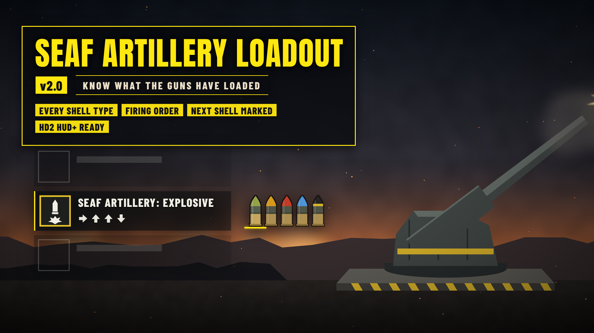

# SEAF Artillery Loadout

*Know what the guns have loaded.*

**Download:** `SEAF-Artillery-Loadout-1.0.0.zip` from the [latest release](https://github.com/Th3chef/SEAF-Artillery-Loadout/releases/latest) (not the source code). Needs [Bingus Shared Loader](https://www.nexusmods.com/helldivers2/mods/16292) v19 or newer.

The SEAF artillery fires the shells you loaded into it, one per call-in, in the order they went in. The game only tells you the next one ("SEAF ARTILLERY: EXPLOSIVE"), so after a few shots it's easy to lose track of what's left: is the Mini Nuke still in there, or was that the last High-Yield? This mod shows you the whole loadout, right next to the stratagem.

## Features

- Once the SEAF Artillery objective is done, open your stratagem list: to the right of the **SEAF Artillery** row there is an icon for **every shell still loaded, in firing order**.
- The **next shell** (the one your next call-in fires) is at the front, on a yellow bar.
- Fire one and its icon drops off; the rest move up.
- **Fixes the game's shell name:** the game's own `SEAF ARTILLERY: <shell>` name only gets set when the stratagem lands in your list, so after a shot it can keep naming a shell that was already fired. The mod has the game redo that name whenever the next shell changes, so it always names the shell your next call-in really fires (in your game's language).
- Each shell type has its own color, like the shells in game: Explosive (olive tip), High-Yield Explosive (orange), Mini Nuke (black with a yellow band), Napalm (red), Smoke (gray) and Static Field (blue).
- It only shows while the stratagem list is open; the rest of the time nothing is added to your screen.
- It follows the game's own list: it slides in and fades with it, and sits in the right place at any resolution and HUD scale.
- **On/off in game:** with [Mod Options Menu](https://www.nexusmods.com/helldivers2/mods/16625), the icons and the name fix each have a toggle under ESC > MODS > SEAF ARTILLERY LOADOUT.
- **Light:** with the list closed it does next to nothing (one tiny check a frame); with it open, about 0.01 ms a frame.

## Options

No options in the mod manager: install it and it works. With [Mod Options Menu](https://www.nexusmods.com/helldivers2/mods/16625) installed, two toggles under ESC > MODS > SEAF ARTILLERY LOADOUT (both on to start):

- **Show the loaded shells**: the shell icons.
- **Fix the next-shell name**: has the game redo the `SEAF ARTILLERY: <shell>` name when the next shell changes.

With both off the mod reads and draws nothing.

## Requirements

[Bingus Shared Loader](https://www.nexusmods.com/helldivers2/mods/16292) v19 or newer.
Optional: [Mod Options Menu](https://www.nexusmods.com/helldivers2/mods/16625) for the in-game toggles.

## Install / update

1. Install [Bingus Shared Loader](https://www.nexusmods.com/helldivers2/mods/16292) v19 or newer if you don't have it.
2. Mod manager (Arsenal / HD2 Mod Manager): add `SEAF-Artillery-Loadout-1.0.0.zip` and enable it, then **Purge** and **Deploy**.

## Uninstall

Disable it in your mod manager, then Purge and Deploy. Its log and cache files stay in the Bingus logs folder and can be deleted.

## Compatibility

- A Bingus Shared Loader script: it doesn't replace any game files, so it works alongside other mods.
- It attaches to the game's own stratagem list. Mods that hide that list and show their own (such as HD2 HUD+'s stratagem panel) hide the icons too, so they never float in the wrong place. To see them with HD2 HUD+, turn off its stratagem panel; the icons then show half a second after the list opens the first time, and right away after that.
- Client-side only: nobody else needs the mod.
- Patch-proof by design: it finds what it needs in the game's code by itself after a game update, and it tells the shells apart by the game's own names for them, not by numbers a patch could shuffle. If it can't find something it stays off and says so in its log, rather than guessing.
- Made and tested on the October 2026 game version.

## Known limitations

- Tested solo and hosting. In a game you've joined it reads the same artillery state, which the game keeps in sync for every player, so it should show there too.
- A shell type the game adds in a future update is shown as a gray shell with a "?" until an update gives it its own color.

## How it works

A Bingus Shared Loader Lua addon. It reads game memory; its only write is the name fix's one value in your own HUD (below).
- The SEAF artillery keeps its loaded shells in a small list the game syncs to every player. The mod reads it when your stratagem list opens and four times a second while it stays open, and looks up each shell's name in the game's own data to know its type.
- It finds the SEAF Artillery row in the game's stratagem list and places the icons just right of the list, using the list's own position, size and fade.
- The icons are drawn with the game's own UI drawing, and only redrawn when something changes.
- The name fix: the game's stratagem list keeps the stratagem id of each row and only redoes a row's name when that id changes. When the next shell changes, the mod clears the SEAF Artillery row's kept id once; on its next update the game sees a "new" stratagem and redoes the name itself, with its own code, which names the shell that really fires next. The game puts the id back in that same update. It's your HUD only: nothing is sent to other players. If a game update changes how this works, the fix turns itself off (and says so in its log) while the icons keep working.
- The game's addresses are found by searching the game's code at start-up and cached per game build.

## Troubleshooting

- No icons: check Bingus Shared Loader v19 or newer is installed, the mod is enabled (and on in Mod Options Menu, if you use it) and you Purged and Deployed after installing. The icons only appear once the SEAF Artillery objective is done and shells are loaded, and only while the stratagem list is open.
- Using HD2 HUD+? Its stratagem panel hides the game's list, and the icons with it (see Compatibility).
- Attach the logs to a bug report: *SeafArtilleryLoadout.log* and *BingusSharedLoader.log* in `%LOCALAPPDATA%\CowboyBingus\Helldivers2\Logs` (type %LOCALAPPDATA% into the File Explorer address bar and press Enter). SeafArtilleryLoadout.log shows whether it found what it needs in the game's code, and which shells it saw loaded.

## Building from source

See [src/BUILDING.md](src/BUILDING.md).

## Support

If you like my mods, you can support me on [Patreon](https://www.patreon.com/c/Chefboiardee).

## Credits

- **CowboyBingus**: Bingus Shared Loader and the Mod Options Menu.
- Fonts: Anton and Barlow Condensed (SIL Open Font License).

## License

All rights reserved. See [LICENSE](LICENSE).
